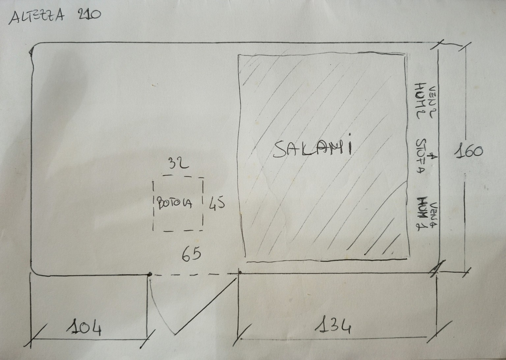

# Salamai — modello Blender, Claude Code + Herdr + revisione Codex

Data: 27 ottobre 2026. Questo documento contiene preparazione ambiente e prompt operativo. È una specifica da eseguire nel repository Salamai: questa specifica non costituisce una implementazione del modello.

## 1. Preparazione ambiente

Percorso consigliato: workstation Ubuntu/Debian con desktop, Blender, Claude Code, Codex CLI e Herdr sulla stessa macchina e nello stesso ambiente utente. Iniziare nativamente, senza Docker e senza distribuire Blender e agenti tra Windows e WSL. Un server senza desktop può eseguire la generazione batch; il controllo interattivo MCP richiede invece Blender aperto con l'add-on attivo.

### Blender

Scaricare una release stabile/LTS dal sito ufficiale https://www.blender.org/download/ e scegliere il pacchetto Linux compatibile con l'architettura della macchina. Estrarre l'archivio in una directory utente e avviare il binario `blender` contenuto nella directory estratta. Aggiungere tale directory al PATH oppure usare il percorso assoluto nei comandi. Annotare la versione scelta nel progetto.

Alternativa semplice su Ubuntu/Debian, da verificare rispetto ai requisiti dell'add-on scelto:

```bash
sudo apt update
sudo apt install blender git curl python3
blender --version
blender
```

La versione dei repository della distribuzione può essere meno recente di quella ufficiale. Non assumere che qualunque combinazione Blender/add-on sia compatibile: eseguire lo smoke test riportato sotto.

Su Windows installare Blender dal sito ufficiale e usare inizialmente Blender e client MCP entrambi nativi. Per Herdr e agenti in WSL preferire dapprima la generazione batch o configurare esplicitamente la connettività: localhost non va assunto equivalente tra tutti gli ambienti.

### uv e MCP per Blender, facoltativo

Il progetto community https://github.com/ahujasid/mcp-for-blender si chiamava `blender-mcp`; il nome consigliato per nuove installazioni è ora `mcp-for-blender`. Non è un prodotto ufficiale della Blender Foundation.

Su Linux installare uv:

```bash
curl -LsSf https://astral.sh/uv/install.sh -o /tmp/salamai-uv-install.sh
less /tmp/salamai-uv-install.sh
sh /tmp/salamai-uv-install.sh
```

Riaprire il terminale, poi:

```bash
uv --version
uvx mcp-for-blender install-addon
claude mcp add blender uvx mcp-for-blender
```

Aprire Blender, abilitare **Interface: MCP for Blender** nelle preferenze degli add-on. Nella vista 3D premere `N`, aprire il pannello MCP e verificare che il server sia avviato. Riavviare Claude Code dopo la registrazione. Se l'installazione automatica non trova Blender, seguire l'installazione manuale di `addon.py` nel README del progetto.

Tenere il collegamento locale. Non abilitare integrazioni per asset esterni, generazione immagini o servizi a pagamento: per questa stanza non servono. Per evitare conflitti, solo Claude controlla la scena interattiva; Codex revisiona file ed esportazioni senza collegarsi contemporaneamente alla stessa scena MCP.

Smoke test: in un file Blender temporaneo chiedere a Claude di elencare la scena, creare un cubo di lato 0,10 m, leggerne le dimensioni e salvarlo. Verificare manualmente dimensioni e file, poi chiudere il test. Registrare le versioni funzionanti di Blender, add-on e pacchetto MCP e fissarle nella documentazione/configurazione del progetto; non aggiornare automaticamente durante un lavoro.

### Herdr e agenti

Servono Claude Code e Codex CLI già installati e autenticati. Verificare `claude --version` e `codex --version`; non inserire credenziali nel repository.

Installare Herdr seguendo il progetto ufficiale:

```bash
curl -fsSL https://herdr.dev/install.sh -o /tmp/salamai-herdr-install.sh
less /tmp/salamai-herdr-install.sh
sh /tmp/salamai-herdr-install.sh
```

Riaprire il terminale. La documentazione di Herdr offre una skill per la collaborazione tra agenti. Per leggere le istruzioni allineate al binario installato:

```bash
herdr --skill
```

È possibile installare la skill ufficiale con il comando documentato `npx skills add herdrdev/herdr --skill herdr -g`, se Node/npx sono disponibili, selezionando gli agenti interessati. In alternativa dare a Claude le istruzioni stampate da `herdr --skill`, senza sovrascrivere istruzioni esistenti.

Entrare nel clone locale di Salamai, avviare `herdr` e, dentro un suo pannello, avviare `claude`. Dare a Claude la sezione 2 di questo documento. Claude deve leggere la skill Herdr e aprire o riutilizzare un pannello Codex per la revisione. I comandi dettagliati di coordinamento vanno ricavati dalla versione installata, non inventati.

Herdr gestisce i terminali: la revisione deve essere effettivamente avviata e il suo risultato acquisito. La sola presenza dei due pannelli non equivale a una revisione.

### Senza MCP

L'MCP migliora l'interazione con Blender ma non è una dipendenza del modello. Dopo l'implementazione sarà disponibile un comando equivalente a:

```bash
blender --background --factory-startup --python-exit-code 1 --python tools/room3d/build_scene.py -- --config model/room3d/room.json --output build/room3d
```

Questo comando è un contratto da implementare, non è ancora disponibile nel repository. Lo script usa il Python incluso in Blender; non occorre installare `bpy` nel Python di sistema. Il rendering CPU deve essere supportato per non richiedere una GPU dedicata.

## 2. PROMPT DA DARE A CLAUDE CODE

Agisci come implementatore principale del progetto Salamai. Costruisci un modello 3D tecnico parametrico della camera di asciugatura usando Blender e Python. Usa Herdr per coordinare un agente Codex indipendente come revisore. Completa implementazione, verifiche, correzioni e documentazione; non fermarti alla pianificazione.

### Avvio e collaborazione

1. Leggi AGENTS.md, CLAUDE.md e le istruzioni applicabili. Ispeziona repository, documentazione, distinta base, schema impianto, software e telemetria realmente presenti. Non presumere nomi di endpoint o dispositivi.
2. Controlla lo stato Git e preserva modifiche altrui. Usa un branch dedicato, senza reset distruttivi, push forzati o merge automatici su main.
3. Verifica Blender, Python, Herdr, Claude e Codex disponibili. Leggi `herdr --skill` e segui le istruzioni della versione installata. Se non sei dentro Herdr non controllare sessioni estranee: continua il lavoro indipendente e segnala come avviare la parte di revisione nel contesto corretto.
4. Claude è l'unico autore di codice, configurazione e scena. Codex revisiona uno snapshot/commit preciso, esegue verifiche in directory separate e restituisce osservazioni. Evita scritture concorrenti sullo stesso .blend e sugli stessi output.
5. Se Codex o Herdr non sono disponibili, completa ciò che è eseguibile e prepara l'handoff, indicando chiaramente «revisione Codex non eseguita». Non impersonare Codex e non dichiarare approvazioni inesistenti.

### Obiettivo

Un modello misurabile, riproducibile e organizzato in layer, utilizzabile per progettare tubazioni e ventole e correlare la disposizione fisica con lo storico dei cicli. Il modello non deve dipendere da modifiche manuali non registrate nel file .blend.

Prima versione: geometria stanza, layer, configurazione dati, generatore, viste quotate, esportazioni e pacchetto analisi AI con esempio di telemetria esplicitamente sintetica. Integra dati reali solo se accessibili e documentati nel repository. Non introdurre nuovi backend, dashboard, database o simulazioni CFD per completare questa prima versione.

### Rilievo e coordinate

Unità canonica: metri; visualizzazione quote in centimetri. Sistema destrorso Z-up. Origine sul pavimento nell'angolo sinistro della parete con porta, come visto nella pianta. X verso destra lungo tale parete; Y verso la parete opposta; Z verso il soffitto.

Misure interne ricavate dallo schizzo e dalle indicazioni dell'utente:
- X stanza: 3,03 m = 1,04 + 0,65 + 1,34.
- Y stanza: 1,60 m.
- Z stanza: 2,10 m.
- Porta sulla parete Y=0, da X=1,04 a X=1,69 m; centro X=1,365 m.
- Altezza porta sconosciuta: conservarla come dato non noto. Per visualizzare usare eventualmente un parametro provvisorio, per esempio 1,90 m, marcato chiaramente come assunto e modificabile.
- Botola soffitto: 0,32 m lungo X e 0,45 m lungo Y; centrata rispetto alla porta, centro X=1,365 m.
- Distanza indicata dall'utente tra porta e botola: 0,40 m. ASSUNZIONE NON CONFERMATA: distanza dalla faccia interna della parete porta al bordo più vicino della botola. In questa interpretazione Y minimo=0,40, Y massimo=0,85, centro Y=0,625 m. X minimo=1,205, X massimo=1,525 m. Z=2,10 m.
- Rendere esplicita la scelta bordo/centro nella configurazione; non trasformare l'assunzione in misura verificata.
- Volume interno geometrico lordo: 10,1808 m³. Non equivale al volume libero con prodotti e attrezzature.
- Spessori reali delle pareti sconosciuti: per visualizzazione usare spessori convenzionali esterni al volume interno e marcarli come tali.
- La zona salami è a destra nella pianta. Mancano quote di ingombro, altezze e supporti: usare un placeholder distinto dalle misure reali. Anche posizioni precise di ventole, stufa, umidificatore e sensori sono da rilevare.
- Non dedurre misure dal rapporto in pixel dello schizzo. La porta sembra aprire verso l'esterno: anche cerniera/apertura vanno marcate come interpretazione grafica se non confermate.

Archivia lo schizzo se presente tra gli input; se non è disponibile non dichiarare di averlo copiato e usa le quote sopra come base documentata.

### Sorgente dati e riproducibilità

JSON è la fonte autorevole. Definisci schema e validatore per unità, frame, geometria, componenti, provenienza e incertezze. Ogni entità ha ID stabile, tipo, layer, posizione, dimensioni, orientamento, stato planned/installed/placeholder e source/status dei dati (misurato, dichiarato, derivato, assunto, sconosciuto).

Distingui la quantità sconosciuta dal valore provvisorio usato per disegnarla. Non sostituire sconosciuto con zero. Mantieni note e assunzioni leggibili dalle AI e nella vista tecnica.

Tubazioni: asse tramite punti 3D, diametro interno/esterno ove noto, tratti e raccordi identificati, raggi di curvatura. Lunghezze derivano dalla geometria effettivamente rappresentata; non attribuire coefficienti di perdita non disponibili. Ventole: centro, asse normalizzato e verso nominale dell'aria, diametro e eventuali dati produttore con fonte. PWM e RPM non sono misure di portata.

Le modifiche interattive via MCP devono essere riportate nei JSON e nello script. Fornisci un percorso pratico per modificare coordinate, aggiungere una ventola e cambiare un percorso tubazione. Se non implementi l'esportazione delle modifiche manuali Blender→JSON, documenta che verranno perse alla rigenerazione e usa il JSON come percorso obbligato di modifica.

### Layer / collezioni

Creare collezioni separabili: struttura; aperture; estrazione e ingresso aria; ricircolo; riscaldamento e umidificazione; supporti e prodotto; sensori; quote e annotazioni; analisi temporale.

Pavimento, pareti e soffitto devono essere separabili per viste aperte. Porta e botola sono aperture reali della geometria, non rettangoli sovrapposti a pareti chiuse. Elementi assunti/planned distinguibili per colore o etichetta. Direzioni del soffio con frecce marcate «nominali, non simulate».

### Output e organizzazione

Adatta i percorsi alle convenzioni del repository; proposta:
- model/room3d/room.json, room.schema.json, layouts/, sources/;
- tools/room3d/build_scene.py, validate_config.py, export_analysis.py;
- docs/room3d/README.md, ASSUMPTIONS.md, REVIEW.md;
- build/room3d/ per file generati, esclusi da Git salvo diversa policy esistente.

Produrre .blend, .glb, manifest JSON con ID e frame, pianta quotata, due sezioni e vista assonometrica aperta in PNG. Gestire l'esportazione glTF Y-up con trasformazione esplicita rispetto al JSON Z-up e verificarne orientamento e scala. Conservare gli ID negli extras quando supportato; layer e metadati devono comunque esistere nel manifest anche se il formato non conserva tutte le collezioni.

Nessun asset fotorealistico esterno necessario. Il .blend e il GLB sono derivati rigenerabili. Le etichette devono essere leggibili e non coperte dalle pareti; verificare visivamente tutte le immagini.

### Collegamento ai cicli

Ogni ciclo fa riferimento a una revisione immutabile della disposizione (layout_id + hash del JSON canonico + commit dei sorgenti ove disponibile). Se la disposizione cambia durante il ciclo, registrare intervalli di validità o eventi con timestamp. Non applicare il layout corrente retroattivamente ai cicli storici.

Per ogni sensore/attuatore predisporre un mapping verso gli ID reali presenti nel progetto. Se assenti, lasciare mapping non risolti. Esportare pacchetto AI contenente geometria, layout, immagini, unità e timestamp, qualità/copertura delle misure, dati o aggregati del periodo, eventi e metadati del carico prodotto. Il pacchetto deve funzionare anche senza un modello multimodale grazie ai dati strutturati.

Separare osservazioni, inferenze e ipotesi. Vietato inventare campi di velocità o mappe di umidità da una sola sonda. Con pochi sensori mostrare punti misurati e zone non osservate. Nessuna conclusione automatica di sicurezza alimentare dal modello 3D.

### Verifiche e criteri di accettazione

- Rigenerazione da configurazione in una directory pulita, senza MCP e senza GUI; exit code non zero in caso di errore.
- Quote interne e coordinate delle aperture esatte entro tolleranza dichiarata; test mirati su porta, botola, unità e orientamento esportato.
- Cambio di un parametro produce la modifica attesa senza duplicare oggetti.
- Due build della stessa configurazione hanno stessi ID, geometria e hash semantici; non pretendere identità binaria dei file Blender.
- Dati invalidi (dimensioni negative, ID duplicati, assi nulli, aperture fuori stanza, valori non finiti) producono errori chiari.
- Elementi esterni intenzionali, come tubazioni e anta aperta, sono ammessi con classificazione esplicita.
- Nessuna quota ignota presentata come reale; assunzione dei 40 cm ben visibile.
- Aperture geometricamente libere, layer isolabili, viste leggibili e output riapribili.
- Telemetria di esempio chiaramente sintetica e separata dai dati reali.
- Versioni e comando unico per ricostruire tutto documentati.

### Revisione indipendente Codex

Avvia Codex attraverso Herdr con questa consegna: «Revisiona il commit/snapshot indicato del modello Salamai. Leggi le specifiche, ispeziona codice e configurazione, riproduci la build in output separati, controlla le immagini se il tuo ambiente lo permette. Verifica coordinate botola/porta, quote, assunzioni, Z-up/Y-up, riproducibilità, ID e associazione layout/cicli. Riporta finding con gravità, file, evidenza e correzione proposta. Non modificare l'implementazione né la scena condivisa. Dichiara verifiche non eseguite e limiti. Non approvare senza evidenza.»

Salva il report reale in docs/room3d/REVIEW.md indicando commit esaminato e comandi eseguiti. Claude corregge i problemi, poi richiede a Codex la verifica delle correzioni sul nuovo commit. Se una criticità resta aperta, riportarla esplicitamente. La review conclusiva deve riferirsi ai sorgenti finali, non a una versione precedente.

Consegna finale: riepilogo, file e output, comando di build, istruzioni pratiche per modificare layer e percorsi, misure ancora necessarie, esito delle verifiche e revisione Codex. Prepara commit locali coerenti; non fare push o merge senza autorizzazione del proprietario o istruzioni già presenti nel progetto.

## 3. Avvio rapido della richiesta

Copia questo documento nel clone Salamai, per esempio in `documentazione/Salamai_Blender_Claude_Herdr_Codex.md`. Dentro il pannello Claude avviato in Herdr scrivi:

> Leggi documentazione/Salamai_Blender_Claude_Herdr_Codex.md. Esegui la sezione 2 nel repository corrente. Usa Herdr per far revisionare il risultato a Codex come descritto. Prima verifica l'ambiente; mantieni esplicite le misure non confermate.

## Fonti per la preparazione ambiente

- Blender download: https://www.blender.org/download/
- Blender manuale installazione Linux: https://docs.blender.org/manual/en/latest/getting_started/installing/linux.html
- Blender CLI: https://docs.blender.org/manual/en/latest/advanced/command_line/arguments.html
- MCP community, installazione e client: https://github.com/ahujasid/mcp-for-blender
- uv installazione: https://docs.astral.sh/uv/getting-started/installation/
- Herdr installazione: https://github.com/herdrdev/herdr
- Herdr skill di coordinamento: https://herdr.dev/docs/agent-skill/

I comandi MCP/Herdr sono basati sulla documentazione consultata alla data del documento. Verificare eventuali cambiamenti prima dell'installazione. I comandi di build e i percorsi della soluzione sono specifiche da realizzare, non funzionalità già presenti.

## Schizzo originale di riferimento



Immagine originale fornita da Marco. Integrazione testuale: botola centrata rispetto alla porta, distanza indicata 40 cm; il riferimento bordo/centro resta da confermare come descritto nel prompt.
